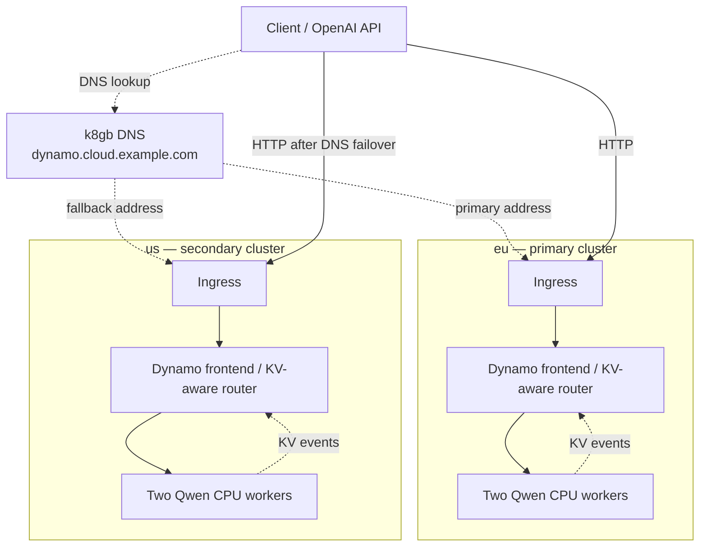

# NVIDIA Dynamo and k8gb

Keep one inference hostname available when a regional endpoint fails, while
routing repeated prompts toward workers that can reuse their KV cache.
**k8gb selects a healthy region through DNS; Dynamo selects a worker within that
region using local cache state.**



In this walkthrough, you send requests to the global hostname, stop the primary
regional frontend, and watch traffic move to the secondary. A separate check shows
Dynamo selecting the workers that hold each warmed prefix.

The CPU profile runs Dynamo 1.6.0 and vLLM 0.30.0 with two **real Qwen3-0.6B
workers** per region. Each worker loads the model weights, generates tokens on
CPU and publishes KV-cache events. A Dynamo operator in each cluster reconciles
a `DynamoGraphDeployment` (DGD) with one frontend and two worker replicas.
No GPU or GPU device plugin is required.

| Responsibility | Component |
| --- | --- |
| Select a healthy regional entry address | k8gb Gslb failover strategy |
| Choose a local worker for each tokenized request | Dynamo's embedded KV router |
| Withdraw an unavailable model from the Service | Kubernetes readiness probe against `/v1/models/Qwen/Qwen3-0.6B/ready` |
| Reconcile frontend and worker replicas | Dynamo operator and the regional DGD |

## Run locally

This opt-in example reuses the existing two-cluster [local playground](local.md),
including nginx ingress, k8gb and BIND9/EdgeDNS.

Run the commands from the repository root. You need Docker, k3d, kubectl and
Helm 3, plus the [local setup prerequisites](local.md#environment-prerequisites).
Reserve at least 8 CPUs and 32 GiB of Docker VM memory for both regional stacks
and the playground. Each of the four workers requests 4 GiB and can use up to
6 GiB, including vLLM process overhead and a 512 MiB KV cache. CPU inference and
the first model download take longer than the previous simulation; use the
model-length and concurrency limits in the manifest.

If the local clusters do not exist yet:

```sh
make deploy-full-local-setup
```

If the local setup uses a separate kubeconfig, set `KUBECONFIG` to that file.
All cluster commands below select their context explicitly.

### 1. Build the CPU image, install the operator and apply the DGD

The example builds on the official vLLM CPU image for the Docker host's
architecture: Linux ARM64 or x86-64. It installs Dynamo's core packages without
the CUDA dependencies from the `ai-dynamo[vllm]` extra. This is a demo image built
locally, not a published NVIDIA CPU runtime image. Do not replace it with a
CUDA-based `vllm-runtime` image on a CPU-only node.

```sh
docker build -t k8gb-dynamo-cpu:1.6.0 \
  -f deploy/dynamo-demo/Dockerfile deploy/dynamo-demo

k3d image import k8gb-dynamo-cpu:1.6.0 -c test-gslb1
k3d image import k8gb-dynamo-cpu:1.6.0 -c test-gslb2
```

Build natively for the cluster's CPU architecture. On other clusters, push the
image to your registry and change all four `image` references in `regional.yaml`.
The nodes need image-registry access. Init containers download the pinned Qwen
revision into pod-local `emptyDir` volumes: tokenizer/config files for the
frontend, and full model weights (about 1.5 GB) for each worker. Init containers
need Hugging Face access; serving containers use `/opt/model` offline. Replacing
a worker downloads the model again. Inspect download progress with
`kubectl logs <pod> -c model`.

Install the version-matched operator in each playground cluster. These commands
install cluster-wide CRDs and admission webhooks and need cluster-admin access.
If a cluster already has a Dynamo operator, reuse a compatible 1.6.0 installation
instead of installing another one. The chart defaults use Kubernetes discovery,
TCP requests and ZMQ events; etcd, NATS, Grove and GPU scheduling are not needed.

```sh
for context in k3d-test-gslb1 k3d-test-gslb2; do
  helm --kube-context "$context" upgrade --install dynamo-platform \
    https://helm.ngc.nvidia.com/nvidia/ai-dynamo/charts/dynamo-platform-1.6.0.tgz \
    --namespace dynamo-system --create-namespace --wait --timeout 5m
done
```

If upgrading from the earlier simulation, remove its directly managed resources
first. This interrupts that demo; the Ingress and Gslb remain in place:

```sh
for context in k3d-test-gslb1 k3d-test-gslb2; do
  kubectl --context "$context" -n dynamo-demo delete \
    deployment,configmap,service dynamo-demo --ignore-not-found
done
```

Apply the same DGD and exposure resources in both clusters:

```sh
kubectl --context k3d-test-gslb1 apply -f deploy/dynamo-demo/regional.yaml
kubectl --context k3d-test-gslb2 apply -f deploy/dynamo-demo/regional.yaml

kubectl --context k3d-test-gslb1 -n dynamo-demo wait \
  dgd/dynamo-demo --for=condition=Ready --timeout=1200s
kubectl --context k3d-test-gslb2 -n dynamo-demo wait \
  dgd/dynamo-demo --for=condition=Ready --timeout=1200s
```

The operator owns the generated Deployments and Services, including
`dynamo-demo-frontend` on port 8000. The Ingress references this frontend Service.
Change replica counts in the DGD; directly scaling a generated Deployment is
reverted by reconciliation. The frontend readiness probe checks the advertised
model, so an empty frontend is not considered a healthy regional endpoint.

The manifest uses `dynamo.cloud.example.com`, with `eu` primary and `us` fallback,
matching the existing local setup. Customize the Ingress hostname or Gslb
`primaryGeoTag` as needed.

### 2. Send a request through the global hostname

Create a small client pod in the secondary cluster. Its DNS resolver is that
cluster's k8gb CoreDNS service, so requests use the global DNS answer. Running
inside k3d also avoids host-to-Docker-network routing issues on macOS.

```sh
dynamo_dns_ip=$(kubectl --context k3d-test-gslb2 -n k8gb get service k8gb-coredns -o jsonpath='{.spec.clusterIP}')

kubectl --context k3d-test-gslb2 -n dynamo-demo delete pod dynamo-client --ignore-not-found

kubectl --context k3d-test-gslb2 -n dynamo-demo run dynamo-client \
  --image=curlimages/curl:8.18.0 --restart=Never \
  --overrides="{\"spec\":{\"dnsPolicy\":\"None\",\"dnsConfig\":{\"nameservers\":[\"$dynamo_dns_ip\"]}}}" \
  --command -- sleep 3600

kubectl --context k3d-test-gslb2 -n dynamo-demo wait pod/dynamo-client --for=condition=Ready --timeout=90s
```

Send a request and print the actual ingress IP it reached:

```sh
kubectl --context k3d-test-gslb2 -n dynamo-demo exec dynamo-client -- \
  curl -sS --fail-with-body --max-time 180 \
  -w '\nHTTP %{http_code}, ingress IP %{remote_ip}\n' \
  -H 'Content-Type: application/json' \
  -d '{"model":"Qwen/Qwen3-0.6B","messages":[{"role":"user","content":"Hello"}],"max_tokens":32,"stream":false,"chat_template_kwargs":{"enable_thinking":false}}' \
  http://dynamo.cloud.example.com/v1/chat/completions
```

Expect HTTP 200 and an address from the **primary** cluster's Ingress. Compare
addresses with these commands; the generated answer does not identify a region:

```sh
kubectl --context k3d-test-gslb1 -n dynamo-demo get ingress dynamo-demo
kubectl --context k3d-test-gslb2 -n dynamo-demo get ingress dynamo-demo
```

### 3. Demonstrate failover and failback

Stop the primary frontend through the DGD. The first component in the supplied
manifest is `Frontend`; workers remain running with their caches:

```sh
kubectl --context k3d-test-gslb1 -n dynamo-demo patch dgd dynamo-demo --type=json \
  -p '[{"op":"test","path":"/spec/components/0/name","value":"Frontend"},{"op":"replace","path":"/spec/components/0/replicas","value":0}]'
```

Repeat the curl command from step 2 until it returns HTTP 200 from a **secondary**
ingress IP. DNS and ingress convergence can cause temporary failures.

To observe the delegated BIND9 answer as well:

```sh
dig @127.0.0.1 -p 1053 dynamo.cloud.example.com +short +tcp
```

Repeat the lookup until it shows secondary addresses. BIND9 caches answers, so
this may take longer than the client pod's direct CoreDNS lookup.

Restore the primary, then repeat curl and dig until both return primary addresses:

```sh
kubectl --context k3d-test-gslb1 apply -f deploy/dynamo-demo/regional.yaml
kubectl --context k3d-test-gslb1 -n dynamo-demo wait \
  deployment/dynamo-demo-frontend --for=jsonpath='{.spec.replicas}'=1 --timeout=60s
kubectl --context k3d-test-gslb1 -n dynamo-demo rollout status \
  deployment/dynamo-demo-frontend --timeout=300s
```

Restore the primary even if you stop the walkthrough early. This exercise tests
regional frontend loss, not a whole-cluster outage or WAN partition. Existing
streams are not migrated; DNS caches and connection reuse affect recovery time.

### 4. Verify local KV-aware routing

Run the verification test inside each frontend container:

```sh
kubectl --context k3d-test-gslb1 -n dynamo-demo exec -i deployment/dynamo-demo-frontend -c main -- \
  python3 - < deploy/dynamo-demo/check-kv.py

kubectl --context k3d-test-gslb2 -n dynamo-demo exec -i deployment/dynamo-demo-frontend -c main -- \
  python3 - < deploy/dynamo-demo/check-kv.py
```

The test warms a different long prefix on each of two workers, then checks that
three requests per prefix **without worker pins or session-affinity headers**
select the respective warm worker and report positive cached-prompt-token counts.
Query-only probes wait for cache-state propagation without warming the wrong
worker. Expect two matching worker IDs, cached-token counts and a `PASS` line per cluster.
This verifies local routing over real vLLM KV-cache events, not cross-DC cache reuse.
It does not measure a latency benefit; use repeated requests and backend metrics
for a separate cache-reuse performance comparison.

### Logs and cleanup

Inspect the DGD, generated workloads and logs in either region:

```sh
kubectl --context k3d-test-gslb1 -n dynamo-demo get dgd,dcd,pods,services
kubectl --context k3d-test-gslb1 -n dynamo-demo logs \
  deployment/dynamo-demo-frontend -c main --tail=50
kubectl --context k3d-test-gslb1 -n dynamo-demo logs \
  -l nvidia.com/dynamo-graph-deployment-name=dynamo-demo,nvidia.com/dynamo-component-type=worker \
  -c main --prefix --tail=50
```

If initialization fails, inspect `kubectl describe pod` and worker logs for model
download errors, CPU instruction incompatibility or out-of-memory termination.
Workers need writable `/tmp` for their model and engine caches. The supplied
limits bound context length, concurrency and KV-cache allocation for this demo.

Delete the dedicated example namespaces and their contents, including the DGD,
its operator-managed children, and the client pod:

```sh
kubectl --context k3d-test-gslb1 delete -f deploy/dynamo-demo/regional.yaml
kubectl --context k3d-test-gslb2 delete -f deploy/dynamo-demo/regional.yaml
```

The operators, cluster-wide CRDs, local clusters and Docker image remain installed.
If the operators were installed only for this demo, remove their Helm releases
once all Dynamo workloads have been deleted:

```sh
helm --kube-context k3d-test-gslb1 uninstall dynamo-platform -n dynamo-system
helm --kube-context k3d-test-gslb2 uninstall dynamo-platform -n dynamo-system
```

Do not uninstall an operator shared by other workloads. CRDs are retained; do not
delete them on a shared cluster.

## Deployment details

Each region has a `nvidia.com/v1beta1` DGD with a `Frontend` component and two
`worker` replicas, each in a separate pod. The operator provides Kubernetes
service discovery, worker metadata and RBAC, so pods must retain the injected
service account and token. No file-discovery volume, etcd or NATS is used.

The worker command is `python3 -m dynamo.vllm` with automatic prefix caching and
KV events enabled, using 32-token blocks supported by the CPU attention kernel.
It performs aggregated prefill and decode on CPU. The engine canary timeout is
120 seconds so a long CPU prefill does not trigger the default three-second
health timeout and restart a busy worker. Health checks remain enabled. No GPU
resource is requested and no cross-worker KV transfer connector is configured.

k8gb never sees prompts, sessions or KV blocks. It cannot supply per-request cache
affinity, HTTP retries or KV replication. Readiness should reflect sustained
serving availability; transient queue pressure belongs to Dynamo's request policy.

## k8gb + Dynamo integration status

This is the first increment toward the architecture
[discussed with @sttts](https://gist.github.com/sttts/2db43697d25a1df78167f33b1b714eaf).
The review used Dynamo main
[`ee0120922eef`](https://github.com/ai-dynamo/dynamo/tree/ee0120922eef6278a25fe94ad491f02aa8aa038e)
on 2026-10-25; the image uses release
[`1.6.0 / 701da25292ec`](https://github.com/ai-dynamo/dynamo/tree/701da25292ecca8f64d770cc0b17d389200019a1).

**Statuses below describe this k8gb example.** Upstream code availability does
not mean a component is deployed or tested here. The demo uses Dynamo's frontend
and local KV router; it does not deploy the Global Router, DC KV Relay or
Cuckoo-filter index.

| Integration capability | Status in this demo | Scope and remaining work |
| --- | --- | --- |
| Regional DNS failover and failback | Acceptance scenario | k8gb changes the regional entry addresses when the primary serving endpoint becomes unavailable and recovers |
| KV-aware worker selection within a region | CPU inference profile | Dynamo's local KV router selects vLLM workers holding warmed prefixes; verify with `check-kv.py` |
| Cache visibility across regions | Planned | Deploy the upstream experimental [DC KV Relay](https://github.com/ai-dynamo/dynamo/blob/ee0120922eef6278a25fe94ad491f02aa8aa038e/docs/fern/pages/developer-guide/knowledge-base/modular-components/router/multi-dc-kv-routing.md) and connect its summaries to the upstream [Cuckoo-filter index](https://github.com/ai-dynamo/dynamo/blob/ee0120922eef6278a25fe94ad491f02aa8aa038e/lib/kv-router/src/indexer/cuckoo/README.md); neither is integrated here |
| KV-aware request routing between regions | Planned; integration required | Connect cache lookup, region selection and request forwarding. The existing upstream [Global Router](https://github.com/ai-dynamo/dynamo/tree/ee0120922eef6278a25fe94ad491f02aa8aa038e/components/src/dynamo/global_router) selects configured pools using prompt length, latency targets and priority, without the relay's cache summaries |
| Whole-region failure and WAN partition handling | Planned | Verify DNS entry failover and Dynamo's request-routing fallback independently, including stale remote cache state |
| Real inference and cache-reuse performance | CPU inference implemented; performance comparison pending | Qwen weights are loaded by vLLM; measure actual cache reuse and time to first token separately |

The CKF producer packs four 16-bit fingerprints per bucket and publishes a snapshot
followed by sequenced, absolute bucket updates. Consumers recover gaps from a new
snapshot. Collisions can give false positives; admission failures can omit entries.
A match is a placement hint, not proof of reusable KV or serving capacity. No KV
tensors cross this publication boundary.

The [relay deployment guide](https://github.com/ai-dynamo/dynamo/blob/ee0120922eef6278a25fe94ad491f02aa8aa038e/docs/fern/pages/kubernetes/kv-aware-routing/kv-dc-relay.md)
requires matching runtime bindings and worker event/recovery endpoints. Kubernetes
discovery needs DynamoWorkerMetadata CRDs, EndpointSlices and RBAC within one
Kubernetes namespace. Direct ZMQ avoids NATS. The WAN listener is plaintext gRPC;
protected exposure requires an external TLS/mTLS proxy. Pool identity, compatible
hash/block semantics, stream freshness and serving-ingress resolution still need
explicit integration.

The [multi-DC routing proposal](https://github.com/ai-dynamo/dynamo/issues/11225)
and [session-placement proposal](https://github.com/ai-dynamo/dynamo/issues/11403)
were open at review time. Session continuity across independent routers is not assumed.

The [vLLM CPU installation guide](https://docs.vllm.ai/en/stable/getting_started/installation/cpu/)
describes CPU architecture and instruction-set requirements. This example uses a
custom CPU image; the standard Dynamo GPU runtime image is not interchangeable.

## Next steps for k8gb + Dynamo

These are proposed increments beyond the current demo. Keep additional components
in opt-in manifests under `deploy/dynamo-demo/`, reuse the existing clusters and
DNS infrastructure, and leave the default local setup and core installation unchanged.

1. **Share cache visibility between regions.** Select an upstream version with
   compatible relay bindings and vLLM worker event/recovery endpoints, then deploy
   a relay in each cluster and connect a CKF consumer. Use distinct regional pool
   identities with compatible token hashing and block sizes. Success means warming
   a prefix in region B makes B appear in the consumer's prefix lookup, and relay
   restart or stream loss retires stale pool state until a fresh snapshot arrives.
2. **Connect cache lookup to cross-region request routing.** Reuse an upstream
   consumer/router integration when available; otherwise prototype the missing
   request-routing component separately from k8gb. Combine cache hints with
   readiness, load and WAN latency, map eligible pools to regional frontends, and
   define streaming, cancellation and safe retry behavior. The acceptance scenario
   is: warm a prefix in B, enter through A, and observe the request reaching B's
   warm worker. k8gb continues to select a healthy entry region through DNS;
   Dynamo's request-routing layer makes the per-request cache decision.
3. **Test the two failure boundaries independently.** With entry region A healthy,
   make destination B unavailable and verify the request router's fallback policy.
   Then take entry region A offline and verify k8gb DNS failover for new connections
   after DNS convergence. Finally, interrupt the WAN connection and verify each
   region can serve locally while stale remote cache information is excluded.
   Record selected regions/workers, HTTP outcomes and recovery times, including
   [split-brain behavior](splitbrain.md).
4. **Measure the benefit.** Compare cache-aware routing with load-only placement
   using actual cache reuse and time to first token, including WAN overhead. CPU
   timings from this small demo do not predict GPU deployment performance.

## Validation scope

Validated the operator-managed CPU profile on Linux ARM64 in a local kind
cluster with Kubernetes 1.30.13, Dynamo operator/runtime 1.6.0 and vLLM 0.30.0:

- The DGD reaches Ready with one frontend and two real CPU workers.
- Non-streaming and streaming chat completions return generated text.
- The KV-placement check selects both warmed workers without affinity headers
  and reports positive cached-token counts on repeated requests.
- Setting the frontend DGD replica count to zero withdraws its Service endpoints.
  Restoring it serves chat completions again without restarting either worker.

The x86-64 image base is published upstream but this profile has not been run on
x86-64. The original simulation's two-cluster DNS results do not validate the
new CPU profile: repeat the k3d DNS failover/failback acceptance steps above.
This validation does not establish inference performance or a recovery-time SLO.

Cross-DC CKF routing, whole-region failure and WAN partitions remain future work.
