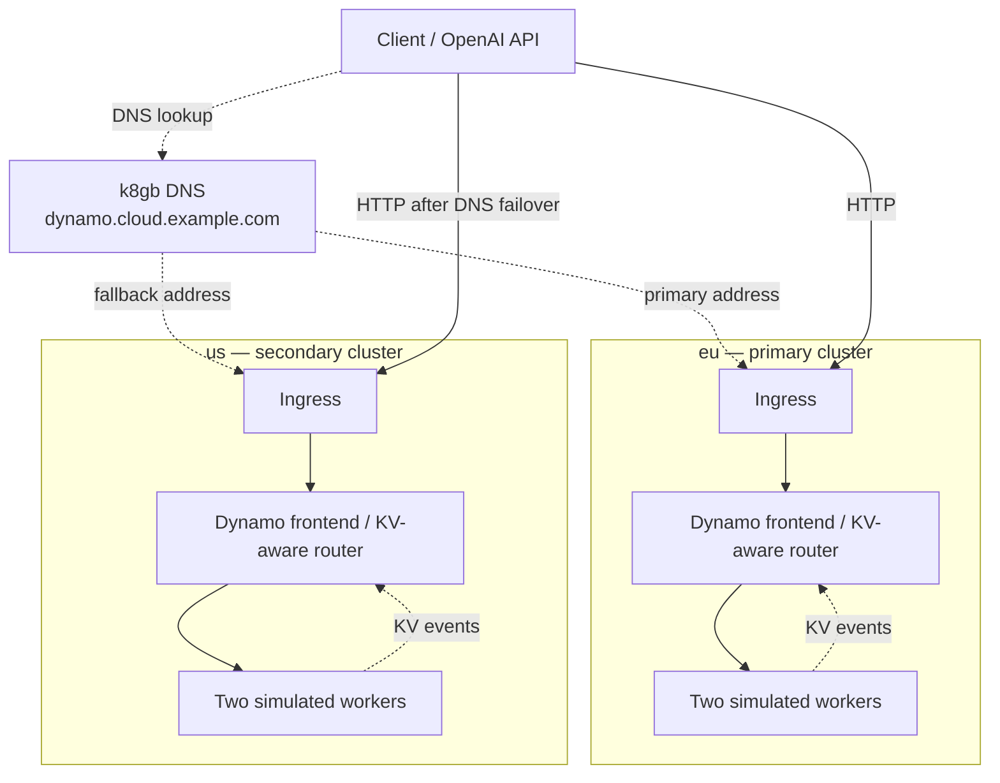

# NVIDIA Dynamo and k8gb

Keep one inference hostname available when a regional endpoint fails, while
routing repeated prompts toward workers that can reuse their KV cache.
**k8gb selects a healthy region through DNS; Dynamo selects a worker within that
region using local cache state.**



In this walkthrough, you send requests to the global hostname, stop the primary
regional stack, and watch traffic move to the secondary. A separate check shows
Dynamo selecting the workers that hold each warmed prefix.

The CPU profile runs Dynamo 1.6.0 with two **simulated workers** per region.
Qwen3-0.6B supplies the tokenizer and configuration; no model weights are loaded.
This demonstrates routing and resilience, not real Qwen inference or GPU performance.

| Responsibility | Component |
| --- | --- |
| Select a healthy regional entry address | k8gb Gslb failover strategy |
| Choose a local worker for each tokenized request | Dynamo's embedded KV router |
| Withdraw an unavailable model from the Service | Kubernetes readiness probe against `/v1/models/Qwen/Qwen3-0.6B/ready` |
| Start and restart frontend and workers | Kubernetes, with one process per container |

## Run locally

This opt-in example reuses the existing two-cluster [local playground](local.md),
including nginx ingress, k8gb and BIND9/EdgeDNS.

Run the commands from the repository root. You need Docker, k3d, kubectl and the
[local setup prerequisites](local.md#environment-prerequisites). Host Python is
not required. If the local clusters do not exist yet:

```sh
make deploy-full-local-setup
```

If your local setup uses a separate kubeconfig, set `KUBECONFIG` to that file
before running the commands below.

### 1. Apply the same manifest to both clusters

The manifest uses NVIDIA's published `nvcr.io/nvidia/ai-dynamo/dynamo-planner:1.6.0`
image for both the frontend and mock workers. Each new pod downloads pinned Qwen
tokenizer/config files in an init container, without model weights. The nodes need
access to `nvcr.io`, and the pods need access to Hugging Face during initialization.

```sh
kubectl --context k3d-test-gslb1 apply -f deploy/dynamo-demo/regional.yaml
kubectl --context k3d-test-gslb2 apply -f deploy/dynamo-demo/regional.yaml

kubectl --context k3d-test-gslb1 -n dynamo-demo rollout status deployment/dynamo-demo --timeout=600s
kubectl --context k3d-test-gslb2 -n dynamo-demo rollout status deployment/dynamo-demo --timeout=600s
```

The manifest uses `dynamo.cloud.example.com`, with `eu` primary and `us` fallback, matching
the existing local setup. To customize it, edit the Ingress hostname, Gslb
`primaryGeoTag`, or all three container image references directly.

### 2. Send a request through the global hostname

Create a small client pod in the secondary cluster. Its DNS resolver is that
cluster's k8gb CoreDNS service, so requests use the global DNS answer. Running
inside k3d also avoids host-to-Docker-network routing issues on macOS.

```sh
dynamo_dns_ip=$(kubectl --context k3d-test-gslb2 -n k8gb get service k8gb-coredns -o jsonpath='{.spec.clusterIP}')

kubectl --context k3d-test-gslb2 -n dynamo-demo delete pod dynamo-client --ignore-not-found

kubectl --context k3d-test-gslb2 -n dynamo-demo run dynamo-client \
  --image=curlimages/curl:8.18.0 --restart=Never \
  --overrides="{\"spec\":{\"dnsPolicy\":\"None\",\"dnsConfig\":{\"nameservers\":[\"$dynamo_dns_ip\"]}}}" \
  --command -- sleep 3600

kubectl --context k3d-test-gslb2 -n dynamo-demo wait pod/dynamo-client --for=condition=Ready --timeout=90s
```

Send a request and print the actual ingress IP it reached:

```sh
kubectl --context k3d-test-gslb2 -n dynamo-demo exec dynamo-client -- \
  curl -sS --fail-with-body --max-time 30 \
  -w '\nHTTP %{http_code}, ingress IP %{remote_ip}\n' \
  -H 'Content-Type: application/json' \
  -d '{"model":"Qwen/Qwen3-0.6B","messages":[{"role":"user","content":"Hello"}],"max_tokens":8,"stream":false}' \
  http://dynamo.cloud.example.com/v1/chat/completions
```

Expect HTTP 200 and an address from the **primary** cluster's Ingress. Compare
addresses with these commands; simulated response text does not identify a region:

```sh
kubectl --context k3d-test-gslb1 -n dynamo-demo get ingress dynamo-demo
kubectl --context k3d-test-gslb2 -n dynamo-demo get ingress dynamo-demo
```

### 3. Demonstrate failover and failback

Stop the primary regional stack:

```sh
kubectl --context k3d-test-gslb1 -n dynamo-demo scale deployment/dynamo-demo --replicas=0
```

Repeat the curl command from step 2 until it returns HTTP 200 from a **secondary**
ingress IP. DNS and ingress convergence can cause temporary failures.

To observe the delegated BIND9 answer as well:

```sh
dig @127.0.0.1 -p 1053 dynamo.cloud.example.com +short +tcp
```

Repeat the lookup until it shows secondary addresses. BIND9 caches answers, so
this may take longer than the client pod's direct CoreDNS lookup.

Restore the primary, then repeat curl and dig until both return primary addresses:

```sh
kubectl --context k3d-test-gslb1 -n dynamo-demo scale deployment/dynamo-demo --replicas=1
kubectl --context k3d-test-gslb1 -n dynamo-demo rollout status deployment/dynamo-demo --timeout=600s
```

Restore the primary even if you stop the walkthrough early. This exercise tests
regional endpoint loss, not a whole-cluster outage or WAN partition. Existing
streams are not migrated; DNS caches and connection reuse affect recovery time.

### 4. Optionally verify local KV-aware routing

Run the verification test inside each frontend container:

```sh
kubectl --context k3d-test-gslb1 -n dynamo-demo exec -i deployment/dynamo-demo -c frontend -- \
  python3 - < deploy/dynamo-demo/check-kv.py

kubectl --context k3d-test-gslb2 -n dynamo-demo exec -i deployment/dynamo-demo -c frontend -- \
  python3 - < deploy/dynamo-demo/check-kv.py
```

The test warms a different long prefix on each of two workers, then checks that
requests **without worker pins or session-affinity headers** select the respective
warm workers. Query-only probes wait for cache-state propagation without warming
the wrong worker. Expect two matching worker IDs and a `PASS` line per cluster.
This verifies local routing over simulated KV state, not cross-DC cache reuse.

### Logs and cleanup

Inspect either container; substitute `k3d-test-gslb2` for the secondary:

```sh
kubectl --context k3d-test-gslb1 -n dynamo-demo logs deployment/dynamo-demo -c frontend --tail=50
kubectl --context k3d-test-gslb1 -n dynamo-demo logs deployment/dynamo-demo -c workers --tail=50
```

If the pod is still initializing, inspect the tokenizer download with
`kubectl --context k3d-test-gslb1 -n dynamo-demo logs deployment/dynamo-demo -c tokenizer`.

If a previously working demo stays unready and worker logs report
`FileStore::keep_alive failed opening owned file`, its file-discovery registrations
have been lost. A long host or Docker VM pause can allow those registrations to
expire. Restart the affected demo deployment to recreate discovery state; applying
an unchanged manifest does not restart it. To recover both regions:

```sh
kubectl --context k3d-test-gslb1 -n dynamo-demo rollout restart deployment/dynamo-demo
kubectl --context k3d-test-gslb2 -n dynamo-demo rollout restart deployment/dynamo-demo

kubectl --context k3d-test-gslb1 -n dynamo-demo rollout status deployment/dynamo-demo --timeout=600s
kubectl --context k3d-test-gslb2 -n dynamo-demo rollout status deployment/dynamo-demo --timeout=600s
```

This resets simulated caches; rerun the optional KV check to warm and verify them.

Delete the example when finished. These commands remove the dedicated
`dynamo-demo` namespaces and their contents, including the client pod, while
leaving the local clusters and image available:

```sh
kubectl --context k3d-test-gslb1 delete -f deploy/dynamo-demo/regional.yaml
kubectl --context k3d-test-gslb2 delete -f deploy/dynamo-demo/regional.yaml
```

## Deployment details

Each region has one pod containing a frontend container and a container running
two mock workers. They share an `emptyDir` for file discovery and use TCP/ZMQ
locally. A separate `emptyDir` holds the tokenizer files for the pod's lifetime;
recreating the pod downloads them again. No Dynamo operator, etcd, NATS or
additional DNS infrastructure is needed.
File discovery is confined to this pod; production multi-pod workers need a
suitable discovery backend.

k8gb never sees prompts, sessions or KV blocks. It cannot supply per-request cache
affinity, HTTP retries or KV replication. Readiness should reflect sustained
serving availability; transient queue pressure belongs to Dynamo's request policy.

## k8gb + Dynamo integration status

This is the first increment toward the architecture
[discussed with @sttts](https://gist.github.com/sttts/2db43697d25a1df78167f33b1b714eaf).
The review used Dynamo main
[`ee0120922eef`](https://github.com/ai-dynamo/dynamo/tree/ee0120922eef6278a25fe94ad491f02aa8aa038e)
on 2026-10-25; the image uses release
[`1.6.0 / 701da25292ec`](https://github.com/ai-dynamo/dynamo/tree/701da25292ecca8f64d770cc0b17d389200019a1).

**Statuses below describe this k8gb example.** Upstream code availability does
not mean a component is deployed or tested here. The demo uses Dynamo's frontend
and local KV router; it does not deploy the Global Router, DC KV Relay or
Cuckoo-filter index.

| Integration capability | Status in this demo | Scope and remaining work |
| --- | --- | --- |
| Regional DNS failover and failback | Tested | k8gb changes the regional entry addresses when the primary serving endpoint becomes unavailable and recovers |
| KV-aware worker selection within a region | Tested with simulated workers | Dynamo's local KV router selects workers holding warmed prefixes; no model weights are loaded |
| Cache visibility across regions | Planned | Deploy the upstream experimental [DC KV Relay](https://github.com/ai-dynamo/dynamo/blob/ee0120922eef6278a25fe94ad491f02aa8aa038e/docs/fern/pages/developer-guide/knowledge-base/modular-components/router/multi-dc-kv-routing.md) and connect its summaries to the upstream [Cuckoo-filter index](https://github.com/ai-dynamo/dynamo/blob/ee0120922eef6278a25fe94ad491f02aa8aa038e/lib/kv-router/src/indexer/cuckoo/README.md); neither is integrated here |
| KV-aware request routing between regions | Planned; integration required | Connect cache lookup, region selection and request forwarding. The existing upstream [Global Router](https://github.com/ai-dynamo/dynamo/tree/ee0120922eef6278a25fe94ad491f02aa8aa038e/components/src/dynamo/global_router) selects configured pools using prompt length, latency targets and priority, without the relay's cache summaries |
| Whole-region failure and WAN partition handling | Planned | Verify DNS entry failover and Dynamo's request-routing fallback independently, including stale remote cache state |
| Real inference and cache-reuse performance | Planned | Validate a supported backend and hardware profile, then measure the benefit of cache-aware placement |

The CKF producer packs four 16-bit fingerprints per bucket and publishes a snapshot
followed by sequenced, absolute bucket updates. Consumers recover gaps from a new
snapshot. Collisions can give false positives; admission failures can omit entries.
A match is a placement hint, not proof of reusable KV or serving capacity. No KV
tensors cross this publication boundary.

The [relay deployment guide](https://github.com/ai-dynamo/dynamo/blob/ee0120922eef6278a25fe94ad491f02aa8aa038e/docs/fern/pages/kubernetes/kv-aware-routing/kv-dc-relay.md)
requires matching runtime bindings and worker event/recovery endpoints. Kubernetes
discovery needs DynamoWorkerMetadata CRDs, EndpointSlices and RBAC within one
Kubernetes namespace. Direct ZMQ avoids NATS. The WAN listener is plaintext gRPC;
protected exposure requires an external TLS/mTLS proxy. Pool identity, compatible
hash/block semantics, stream freshness and serving-ingress resolution still need
explicit integration.

The [multi-DC routing proposal](https://github.com/ai-dynamo/dynamo/issues/11225)
and [session-placement proposal](https://github.com/ai-dynamo/dynamo/issues/11403)
were open at review time. Session continuity across independent routers is not assumed.

The [CPU mocker tutorial](https://github.com/ai-dynamo/dynamo/blob/701da25292ecca8f64d770cc0b17d389200019a1/docs/fern/pages/cli/operations/simulation-with-dynosim/mocker-live-simulation.mdx)
supports this Qwen simulation. The
[normal serving guide](https://github.com/ai-dynamo/dynamo/blob/701da25292ecca8f64d770cc0b17d389200019a1/docs/fern/pages/cli/installation/install-dynamo.mdx)
targets GPU backends. An upstream
[XPU/CPU decode example](https://github.com/ai-dynamo/dynamo/blob/701da25292ecca8f64d770cc0b17d389200019a1/examples/backends/vllm/launch/xpu/disagg_hetero_cpu_decode.sh)
does not establish an all-CPU ARM64 Qwen serving stack. Use the separate
[Ollama demo](ai-inference-demo.md) for real CPU inference; HTTP compatibility
alone does not provide Dynamo KV events.

## Next steps for k8gb + Dynamo

These are proposed increments beyond the current demo. Keep additional components
in opt-in manifests under `deploy/dynamo-demo/`, reuse the existing clusters and
DNS infrastructure, and leave the default local setup and core installation unchanged.

1. **Share cache visibility between regions.** Select an upstream version with
   compatible relay bindings and mock-worker event/recovery endpoints, then deploy
   a relay in each cluster and connect a CKF consumer. Use distinct regional pool
   identities with compatible token hashing and block sizes. Success means warming
   a prefix in region B makes B appear in the consumer's prefix lookup, and relay
   restart or stream loss retires stale pool state until a fresh snapshot arrives.
2. **Connect cache lookup to cross-region request routing.** Reuse an upstream
   consumer/router integration when available; otherwise prototype the missing
   request-routing component separately from k8gb. Combine cache hints with
   readiness, load and WAN latency, map eligible pools to regional frontends, and
   define streaming, cancellation and safe retry behavior. The acceptance scenario
   is: warm a prefix in B, enter through A, and observe the request reaching B's
   warm worker. k8gb continues to select a healthy entry region through DNS;
   Dynamo's request-routing layer makes the per-request cache decision.
3. **Test the two failure boundaries independently.** With entry region A healthy,
   make destination B unavailable and verify the request router's fallback policy.
   Then take entry region A offline and verify k8gb DNS failover for new connections
   after DNS convergence. Finally, interrupt the WAN connection and verify each
   region can serve locally while stale remote cache information is excluded.
   Record selected regions/workers, HTTP outcomes and recovery times, including
   [split-brain behavior](splitbrain.md).
4. **Validate real inference and its benefit.** Add an optional serving profile
   using a validated Dynamo backend and suitable hardware. Use Qwen3-0.6B if that
   backend supports it; all-CPU operation remains a compatibility check. Compare
   cache-aware routing with load-only placement using actual cache reuse and time
   to first token, including WAN overhead. The current simulated workers establish
   routing behavior, not inference performance.

## Tested scope

Tested on ARM64 Colima with six CPUs, about 12 GB memory and k8gb v1.0.0 in two
k3d clusters. Local KV-aware routing and HTTP failover from primary to secondary
and back were verified.

Cross-DC CKF routing, real model-weight inference, whole-region failure and WAN
partitions remain future work.
